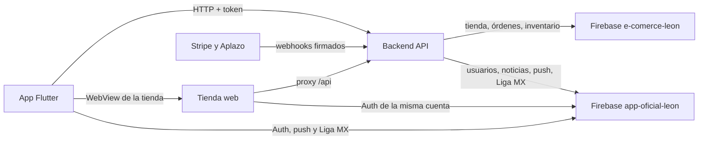

# Ecosistema Club León

Tres productos comparten una sola fuente de verdad. El backend guarda los datos y aplica las reglas. La tienda web es la experiencia de compra. La app es la experiencia móvil del aficionado y abre esa misma tienda cuando toca comprar.

## Las tres piezas

| Pieza | Repositorio | Qué hace |
| --- | --- | --- |
| Backend | `BackendCL` | Lógica, datos, permisos, precios, inventario, órdenes y pagos. |
| Tienda web | `TiendaFrontCL` | Catálogo, carrito, checkout, historial y paneles de operación. |
| App | `FrontClubLeon` | Inicio, calendario, plantilla, rewards y acceso a la tienda. |

La tienda y la app muestran resultados. El backend los confirma.

## Cómo se comunican

Hay un solo API público:

| Entorno | API |
| --- | --- |
| Producción | `https://us-central1-e-comerce-leon.cloudfunctions.net/api` |
| Local | `http://localhost:3000/api` |

La tienda publicada está en `https://tiendalaguarida.com`. En local corre en `http://localhost:9002`.

### Tienda web hacia el backend

El navegador llama a rutas del propio sitio (`/api/...`). Next.js reenvía esa petición al backend, con la sesión del usuario. El secreto de pagos y la validación de precios se quedan en el servidor.

### App hacia el backend

La app llama al mismo API por HTTP. Inicia sesión con Firebase y cambia el ID token por una sesión del backend en `/auth/register-or-login`. Con esa sesión pide noticias, beneficios, perfil, notificaciones y el resto de datos del club.

### App hacia la tienda

La pestaña Tienda no reconstruye el checkout. Abre la tienda web dentro de un WebView y le pasa la sesión de Firebase para que el usuario llegue ya identificado. Comprar en el celular y comprar en el navegador usan la misma tienda y el mismo backend.

### Pagos hacia el backend

Stripe y Aplazo cobran. El backend marca la orden como pagada cuando llega la confirmación firmada del proveedor. La pantalla de éxito de la tienda informa el estado; no lo decide.

## Dónde viven los datos

Hay dos proyectos de Firebase. El backend es el único que escribe en ambos con privilegios de administrador.

| Proyecto | Para qué sirve |
| --- | --- |
| `e-comerce-leon` | API, base `tiendacl` (productos, órdenes, inventario, ofertas) y hosting de la tienda. |
| `app-oficial-leon` | Cuenta del aficionado, push, imágenes de noticias y galería, y datos de Liga MX que lee la app. |

La cuenta es una sola. Tienda y app autentican contra `app-oficial-leon`. El backend verifica ese token y autoriza cada acción.

La app lee en directo el calendario, la clasificación y la plantilla que el backend ya sincronizó en `app-oficial-leon`. El catálogo y las órdenes no se leen así: pasan por el API.

## Qué hace cada uno

### Backend

Cloud Functions con una API Express. Calcula precio base, oferta, código, envío y total. Reserva inventario, crea la orden e inicia el pago con ese total. También publica noticias, beneficios, plantilla, notificaciones y la sincronización de Liga MX.

Reglas que solo él puede cerrar:

- precio, descuento, envío y total
- estado de pago y de la orden
- inventario
- rol de administrador y dueño de cada recurso

### Tienda web

Next.js. Es el recorrido de compra: inicio, catálogo, ficha, carrito, checkout, confirmación e historial. También incluye los paneles para operar productos, ofertas, inventario, órdenes, noticias y beneficios. Esos paneles facilitan el trabajo; el permiso real lo vuelve a revisar el backend.

En el checkout el usuario elige recoger en tienda o envío a domicilio, y paga con Stripe o Aplazo. La tienda enseña el resumen. El cobro usa el total que guardó el backend.

### App

Flutter, publicada como app oficial del club (`mx.clubleon.oficial`). La navegación principal es nativa:

| Pestaña | Experiencia |
| --- | --- |
| Inicio | Casa del aficionado: noticias y acceso a su cuenta. |
| Calendario | Partidos y clasificación. |
| Plantilla | Jugadores del club. |
| Rewards | Beneficios y puntos. |
| Tienda | La tienda web, dentro de la app. |

También cubre registro, perfil, QR, ajustes de notificaciones y el widget de racha. El login puede ser correo, Google o Apple. Las notificaciones llegan por Firebase Cloud Messaging.

## Recorrido de una compra

1. La persona entra a la tienda desde el navegador o desde la pestaña Tienda de la app.
2. Elige productos. La tienda pide el catálogo al backend.
3. En checkout, el backend recalcula productos, oferta, código y envío, y crea la orden.
4. Stripe o Aplazo cobran ese total.
5. El proveedor avisa al backend. Si la confirmación es válida, la orden queda pagada.
6. La tienda muestra el estado. El usuario lo consulta igual en la web y, con la misma cuenta, desde la app.

## Límites

- Secretos, llaves de pago y cuentas de servicio viven en el backend.
- Un precio o un rol enviados por la tienda o la app no sustituyen el cálculo del backend.
- La app no tiene una lógica de cobro aparte. Compra con la tienda web.
- Socios de lealtad externos usan un acceso propio (`/loyalty/v1`), distinto de la sesión de la tienda y de la app.
